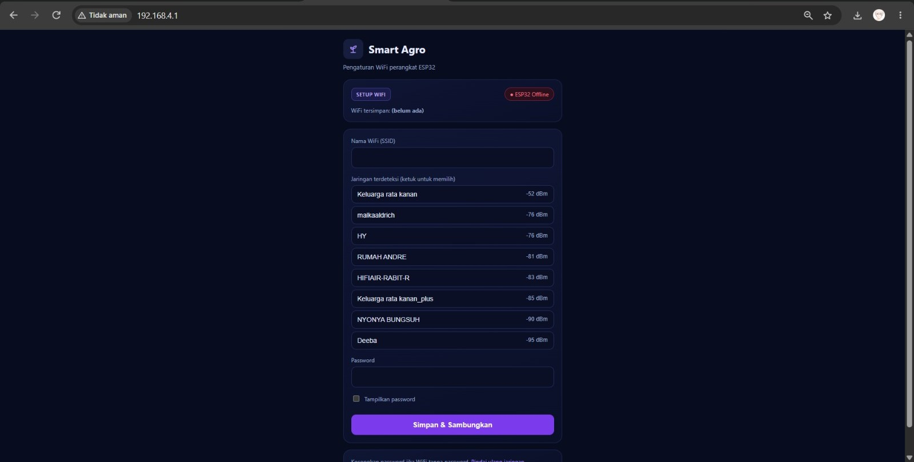

# Smart Agro Dev — Precision Farming & IoT System

<p align="center">
  
</p>

<p align="center">
  <b>Sistem Pemantauan Nutrisi Tanah & Irigasi Otomatis Berbasis IoT, Predictive Decision Engine, dan Hybrid Serverless Architecture.</b>
</p>

---

## !!!Lokasi file untuk Website ada di root repository, dan untuk sourcecode firmware IoT ada di folder "firmware"!!!

## Daftar Isi
- [Deskripsi & Latar Belakang](#-deskripsi--latar-belakang)
- [Arsitektur & Alur Kerja Sistem](#-arsitektur--alur-kerja-sistem)
- [Fitur Utama](#-fitur-utama)
- [Spesifikasi Perangkat Keras & Skema Wiring](#-spesifikasi-perangkat-keras--skema-wiring)
- [Panduan Firmware ESP32 (V9)](#-panduan-firmware-esp32-v9)
  - [Struktur File Firmware](#struktur-file-firmware)
  - [Pengaturan WiFi & Captive Portal](#pengaturan-wifi--captive-portal)
  - [Konfigurasi Mode Relay](#konfigurasi-mode-relay)
  - [Kontrak Topik MQTT & Telemetri](#kontrak-topik-mqtt--telemetri)
- [Panduan Dashboard Web & API](#-panduan-dashboard-web--api)
  - [Persiapan & Eksekusi Lokal](#persiapan--eksekusi-lokal)
  - [Integrasi Google Sheets & Apps Script](#integrasi-google-sheets--apps-script)
  - [Deployment ke Vercel](#deployment-ke-vercel)
- [Pemecahan Masalah (Troubleshooting)](#-pemecahan-masalah-troubleshooting)
- [Identitas Tim](#-identitas-tim)

---

## Deskripsi & Latar Belakang

Penyiraman dan pemupukan yang tidak terukur sering kali menjadi penyebab utama penurunan produktivitas tanaman, pemborosan sumber daya air, hingga kejenuhan tanah. Pemeriksaan kondisi lahan secara manual juga menyulitkan petani dalam memantau dinamika nutrisi secara berkelanjutan.

**Smart Agro** hadir sebagai solusi terpadu untuk memantau kondisi biokimiawi tanah (pH, Suhu, Kelembapan, EC, N, P, K) dan mengendalikan 4 unit pompa irigasi secara jarak jauh. Sistem ini menggabungkan kecerdasan lokal (*Edge Computing* pada ESP32) dengan kecerdasan awan (*Predictive Decision Engine* berbasis **Open-Meteo Weather API**) untuk memberikan rekomendasi penyiraman yang presisi serta mencegah pemborosan air saat hujan diprediksi akan turun.

---

## Arsitektur & Alur Kerja Sistem

```text
[ Sensor JXBS (RS485 Modbus) ]
             │
             ▼
     [ ESP32 MCU (V9) ] ──(OLED SSD1306 Display)
       │            │
       │ (MQTT TLS) │ (HTTP POST)
       ▼            ▼
[ EMQX Cloud ]   [ Google Sheets CSV ]
       │            │
       └─────┬──────┘
             ▼
  [ Vercel Serverless API ] <──> [ Open-Meteo Weather API ]
             │
             ▼
  [ React 19 SPA Dashboard ]
```

1. **Pengumpulan Data:** ESP32 membaca data sensor tanah via RS485 Modbus RTU dan menampilkannya pada OLED SSD1306.
2. **Transmisi Ganda (Hybrid):** ESP32 mengirim data telemetri JSON via **MQTT TLS (Port 8883)** ke EMQX Cloud, serta menyimpan riwayat historis ke **Google Sheets** via Apps Script.
3. **Analitik Prediktif:** Dashboard React mengambil data telemetri dan mengawinkannya dengan prakiraan cuaca real-time dari Open-Meteo API.
4. **Kendali Aktuator:** Pengguna dapat mengeksekusi saklar pompa dari dashboard. Sinyal perintah dikirim via MQTT menuju ESP32 untuk memicu modul Relay 4-Channel.

---

## Fitur Utama

### Dashboard Web (Front-End & API)
* **Real-Time Monitoring:** Visualisasi instan metrik pH, Suhu, EC, Kelembapan, serta N-P-K tanpa *refresh* halaman.
* **Predictive Decision Engine:** Mengkalkulasi batas kritis kelembapan tanah (<40%) dan prakiraan cuaca 1 jam ke depan untuk memberikan rekomendasi aksi (*Pump ON/OFF*).
* **Simultaneous & Channel Control:** Mendukung eksekusi saklar individual (Pompa 1–4) atau saklar global secara bersamaan.
* **Fallback Storage:** Mendukung pembacaan data cadangan dari Google Sheets CSV apabila koneksi MQTT mengalami kendala.

### 🔌 Perangkat Keras & Firmware ESP32 (V9)
* **WiFi Setup Portal (Captive Portal):** Konfigurasi SSID & Password WiFi dapat dilakukan langsung melalui smartphone via Web Portal atau Serial Monitor tanpa *hardcode* di skrip program.
* **Flexible Relay Control Modes:** Pilihan 3 mode relay (`RELAY=0, 1, 2`) yang tersimpan di flash memory untuk mendukung berbagai varian modul relay (Active LOW/HIGH).
* **Fitur Pengaman Otomatis:** *Safety Timeout* mematikan pompa secara otomatis setelah **30 menit** menyala nonstop (`MAX_RUN_MS`).
* **Modular Logic C Engine:** Pemisahan logika murni C (`agro_logic.c`) untuk kalkulasi CRC Modbus, parsing MQTT, dan formatting teks OLED.

---

## Spesifikasi Perangkat Keras & Skema Wiring

<p align="center">
  
</p>

### Connection Pinout

| Komponen / Fungsi | Pin ESP32 Dev Module | Catatan Teknis |
|---|---|---|
| **Relay IN1 – IN4** | GPIO 15, 26, 32, 33 | Mendukung mode Aktif-LOW / Aktif-HIGH |
| **RS485 DI (TX)** | GPIO 17 | Transmisi serial Modbus RTU |
| **RS485 RO (RX)** | GPIO 16 | Gunakan pembagi tegangan (1kΩ & 2kΩ) karena output RO 5V |
| **RS485 DE + RE** | GPIO 4 | Disatukan untuk kontrol arah data RS485 |
| **OLED SSD1306 (I2C)** | SDA GPIO 21, SCL GPIO 22 | Alamat I2C: `0x3C` |
| **LED Indikator WiFi** | GPIO 2 | LED Bawaan Board (Status WiFi/Portal) |
| **Tombol Setup / Reset** | GPIO 0 | Tombol BOOT (Tahan 3 detik untuk buka portal) |

### Peta Register Modbus RTU (Sensor JXBS - ID 0x01, 9600 Baud, 8E1)

| Parameter | Register Modbus | Skala / Formula |
|---|---|---|
| **pH Tanah** | `0x0006` | ÷ 100 |
| **Suhu Tanah** | `0x0013` | ÷ 10 °C |
| **EC (Konduktivitas)** | `0x0015` | × 1 µS/cm |
| **Kelembapan Tanah** | `0x0012` | ÷ 10 % |
| **Nitrogen (N), Fosfor (P), Kalium (K)** | `0x001E` s/d `0x0020` | × 1 mg/kg (ppm) |

---

## Panduan Firmware ESP32 (V9)

### Struktur File Firmware

Direktori `SMART_AGRO_FINAL_V9/` wajib memuat file berikut dalam satu folder:

```text
SMART_AGRO_FINAL_V9/
├── SMART_AGRO_FINAL_V9.ino    // Program utama (Setup, Loop, Hardware)
├── agro_logic.c / .h          // Logika murni C (Modbus CRC, MQTT parsing, OLED format)
├── wifi_setup.cpp / .h        // Pengelolaan WiFi, Flash Preferences, & Portal AP
└── secrets.h                  // Kredensial rahasia (MQTT Broker Host/User/Pass)
```

> **Library Arduino yang Wajib Diinstal:** `Adafruit GFX Library`, `Adafruit SSD1306`, `PubSubClient`, dan `ArduinoJson` (Versi 7.x).

---

### Pengaturan WiFi & Captive Portal

<p align="center">
  
</p>

Jika ESP32 belum terhubung ke jaringan atau ingin mengganti WiFi, portal konfigurasinya dapat dibuka dengan cara:
1. Tahan tombol **BOOT (GPIO 0)** selama 3 detik, atau
2. Ketik perintah `PORTAL` pada Serial Monitor (Baudrate `115200`), atau
3. Otomatis terbuka jika WiFi tersimpan gagal terhubung dalam 2 menit.

**Langkah Koneksi via HP:**
1. Sambungkan HP ke WiFi AP: **`SmartAgro-Setup`** (Password: `smartagro123`).
2. Buka browser dan akses URL: **`http://192.168.4.1`**.
3. Pilih SSID WiFi yang terdeteksi, masukkan password, lalu klik **Simpan & Sambungkan**.

**Perintah Serial Monitor (`115200` Baud, Both NL & CR):**
* `SSID=<nama_wifi>` : Mengatur SSID WiFi.
* `PASS=<password_wifi>` : Mengatur password dan menyambungkan.
* `STATUS` : Menampilkan status koneksi WiFi, MQTT, sensor, dan relay.
* `RELAY=0` / `1` / `2` : Mengubah mode relay.
* `TESRELAY` : Menguji aktuasi relay 1–4 secara bergantian.
* `WIFIRESET` : Menghapus WiFi tersimpan dan membuka portal.

---

### Konfigurasi Mode Relay

Modul relay memiliki karakteristik kelistrikan yang berbeda-beda. Mode dapat dipilih via Serial Monitor tanpa perlu melakukan re-flash kode:

| Mode | Perintah | Status ON | Status OFF | Target Penggunaan |
|---|---|---|---|---|
| **0** | `RELAY=0` | Pin LOW | Pin HIGH | Modul Aktif-LOW Standar. |
| **1** *(Default)* | `RELAY=1` | Pin LOW | Pin Dilepas (INPUT) | Modul Aktif-LOW 5V yang tidak bisa mati oleh sinyal HIGH 3.3V ESP32. |
| **2** | `RELAY=2` | Pin HIGH | Pin LOW | Modul Aktif-HIGH (Jumper di posisi H). |

---

### Kontrak Topik MQTT & Telemetri

* **Port TLS:** `8883` (Enkripsi SSL/TLS)

| Arah Komunikasi | Topik MQTT | Format / Payload |
|---|---|---|
| **Publish (ESP32)** | `smartagro/esp32-01/telemetry` | JSON Data Sensor (Suhu, pH, EC, NPK, Kelembapan) |
| **Publish (ESP32)** | `smartagro/esp32-01/status/pump` | JSON Status Agregat Pompa (Retained Message) |
| **Publish (ESP32)** | `smartagro/esp32-01/status/pump/{1-4}` | JSON Status Pompa Per-Channel (Retained Message) |
| **Subscribe (ESP32)** | `smartagro/esp32-01/command/pump` | `ON` / `OFF` (Mengendalikan Semua Pompa) |
| **Subscribe (ESP32)** | `smartagro/esp32-01/command/pump/{1-4}` | `ON` / `OFF` (Mengendalikan Pompa Spesifik) |

**Contoh Payload Telemetri JSON:**
```json
{
  "deviceId": "esp32-01",
  "temperature": 27.5,
  "moisture": 38.2,
  "ph": 6.8,
  "ec": 520,
  "nitrogen": 34,
  "phosphorus": 22,
  "potassium": 80,
  "tds": 260
}
```

---

## Panduan Dashboard Web & API

### Persiapan & Eksekusi Lokal

**Prasyarat:** Node.js versi 20 atau lebih baru.

1. Clone repositori dan masuk ke direktori proyek:
   ```bash
   git clone https://github.com/ramziazizan/SmartAgro.git
   cd SmartAgro
   ```
2. Install *dependencies* proyek:
   ```bash
   npm ci
   ```
3. Salin file lingkungan backend dari contoh:
   ```bash
   cp backend/.env.example backend/.env
   ```
   *Isikan kredensial MQTT Broker, Username, dan Password Dashboard pada file `.env` tersebut.*

4. Jalankan Server API lokal pada Terminal 1:
   ```bash
   npm run dev:api
   ```
5. Jalankan Frontend Dashboard pada Terminal 2:
   ```bash
   npm run dev
   ```
6. Buka URL lokal yang diberikan oleh Vite (biasanya `http://localhost:5173`).

---

### Integrasi Google Sheets & Apps Script

Sistem menggunakan Google Sheets sebagai basis data cadangan (*fallback*).

1. Buka Google Sheets baru, klik **Extensions → Apps Script**.
2. Masukkan skrip penangkap data berikut:
   ```javascript
   function doGet(e) {
     const p = e.parameter || {};
     const sheet = SpreadsheetApp.getActiveSpreadsheet().getSheets()[0];
     sheet.appendRow([
       new Date(),
       p.ph,
       p.temp,
       p.ec,
       p.moist,
       p.N,
       p.P,
       p.K,
       p.dev
     ]);
     return ContentService.createTextOutput("OK");
   }
   ```
3. Klik **Deploy → New Deployment** $\rightarrow$ Pilih Type: **Web app**.
4. Set **Who has access** ke **Anyone**.
5. Salin URL Web App (`/exec`) dan masukkan ke file `secrets.h` pada ESP32 (`WEB_APP_URL`) serta variabel lingkungan dashboard (`VITE_SHEETS_CSV_URL`).

---

### Deployment ke Vercel

Proyek ini siap di-deploy langsung ke Vercel (Front-end SPA + Vercel Serverless Functions):

1. *Push* repositori Anda ke GitHub.
2. Hubungkan repositori ke **Vercel Dashboard**.
3. Pada bagian **Settings $\rightarrow$ Environment Variables**, tambahkan variabel berikut:
   * `DASHBOARD_USERNAME`
   * `DASHBOARD_PASSWORD`
   * `AUTH_TOKEN_SECRET`
   * `MQTT_BROKER_URL`
   * `MQTT_USERNAME`
   * `MQTT_PASSWORD`
   * `VITE_SHEETS_CSV_URL`
4. Pastikan **Root Directory** disetel ke `./` (akar repositori).
5. Klik **Deploy**.

---

## Pemecahan Masalah (Troubleshooting)

| Gejala Masalah | Kemungkinan Penyebab | Langkah Solusi |
|---|---|---|
| **Nilai sensor di OLED `--` / `null`** | Kabel RS485 A/B terbalik atau masalah daya MAX485. | Tukar kabel A & B RS485. Pastikan VCC MAX485 mendapat pasokan 5V mulus dan GND terhubung sejajar. |
| **Relay selalu ON / tidak mau mati** | Sinyal logika tidak cocok dengan modul relay. | Buka Serial Monitor, coba ganti mode dengan perintah `RELAY=0`, `RELAY=1`, atau `RELAY=2`, lalu jalankan `TESRELAY`. |
| **Login Dashboard "Backend tidak dapat dijangkau"** | Environment Variables belum dikonfigurasi di Vercel. | Buka Vercel Settings $\rightarrow$ Environment Variables, isi kredensial login dan MQTT, lalu lakukan **Redeploy**. |
| **Error `Sketch too big` di Arduino IDE** | Skema partisi memori default terlalu kecil. | Ubah pengaturan di Arduino IDE: **Tools $\rightarrow$ Partition Scheme $\rightarrow$ Huge APP (3MB No OTA)**. |
| **ESP32 Restart saat Pompa Menyala** | *Power dip* / Noise induktif dari beban motor pompa. | Pasang dioda *flyback* (1N4007) pada terminal pompa DC dan kapasitor penstabil pada catu daya ESP32. |

---

## Identitas Tim

Proyek **Smart Agro** dikembangkan oleh Tim Mahasiswa **Universitas Islam Negeri Sumatera Utara (UINSU)**:

* **Ramzi Azizan**
* **M. Taufan Pasya Lubis** 
* **Amanda Putri Rizkita**

**Fakultas Sains dan Teknologi — Program Studi Ilmu Komputer**  
*UIN Sumatera Utara, Indonesia.*