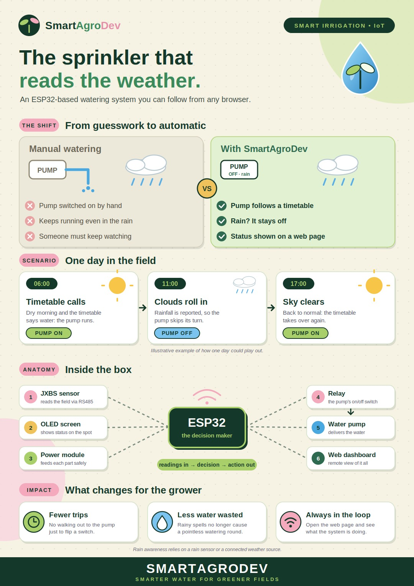
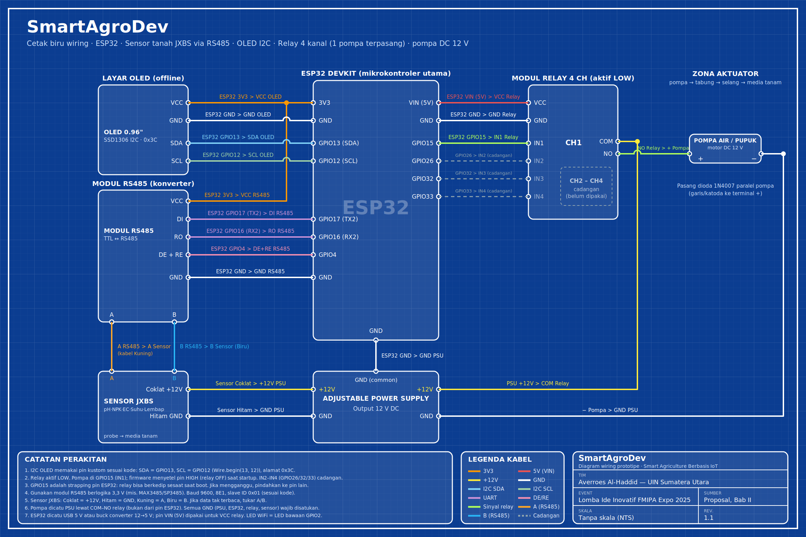

# Smart Agro Dev



## Deskripsi Proyek

Smart Agro adalah sistem pemantauan kondisi tanaman dan pengendalian pompa berbasis ESP32. Sistem ini menggabungkan perangkat sensor, dashboard web, Google Sheets, prakiraan cuaca Open-Meteo, dan komunikasi MQTT.

Dashboard menampilkan data kelembapan tanah, suhu, pH, EC, nitrogen, fosfor, kalium, serta identitas perangkat jika datanya tersedia. Dashboard juga menampilkan prakiraan cuaca dan rekomendasi tindakan penyiraman.

## Latar Belakang dan Tujuan

Penyiraman yang tidak sesuai kebutuhan dapat membuat tanaman kekurangan air atau menggunakan air secara berlebihan. Pemeriksaan kondisi tanaman secara manual juga menyulitkan pemantauan berkelanjutan.

Smart Agro dibuat untuk membantu memantau kondisi tanaman melalui satu dashboard, mempertimbangkan kelembapan tanah dan prakiraan hujan saat memberikan rekomendasi, serta menyediakan kendali pompa dari jarak jauh melalui MQTT. Tujuannya adalah membantu pengguna mengambil keputusan penyiraman dengan informasi yang lebih mudah diakses.

## Cara Kerja Sistem

### Perangkat

Firmware pada [Source Code Tools IoT/SMART_AGRO_FINAL_V7.ino](./Source%20Code%20Tools%20IoT/SMART_AGRO_FINAL_V7.ino) membaca sensor tanah RS485 Modbus RTU (pH, suhu, EC, kelembapan, dan N-P-K), menampilkan hasilnya pada OLED SSD1306, mengirim telemetri/status melalui MQTT, serta mencatat bacaan ke Google Sheets melalui Apps Script. Firmware menyediakan empat keluaran relay yang dapat dikendalikan satu per satu atau sekaligus. Pastikan sambungan dan jumlah pompa fisik sesuai dengan perangkat yang benar-benar dipasang.

> **Catatan integrasi:** sketch ini menerbitkan sensor ke MQTT, tetapi dashboard saat ini membaca sensor dari Google Sheets CSV. Dashboard mendukung telemetry MQTT untuk panel/perangkat bila backend menerima pesan yang sesuai; sumber sensor pada kartu utama tetap dikonfigurasi melalui `VITE_SHEETS_CSV_URL`.

### Dashboard

1. Aplikasi React mengambil baris data terbaru dari Google Sheets melalui URL ekspor CSV.
2. Aplikasi mengambil prakiraan cuaca dari Open-Meteo untuk koordinat Medan.
3. Data dan rekomendasi dashboard diperbarui setiap 15 detik.
4. Sistem menampilkan rekomendasi berdasarkan kelembapan tanah dan prakiraan cuaca:
   - Kelembapan di bawah 40% dan cuaca cerah: rekomendasi pompa hidup.
   - Kelembapan di bawah 40% dan diprediksi hujan: rekomendasi pompa mati.
   - Kelembapan 40% atau lebih: rekomendasi pompa mati.
5. Untuk melihat status perangkat dan mengirim kendali pompa, pengguna login pada panel MQTT. API meneruskan perintah ke broker, lalu ESP32 mengendalikan relay sesuai konfigurasi.

**Catatan:** rekomendasi berdasarkan sensor dan cuaca hanya ditampilkan di dashboard; rekomendasi tersebut belum otomatis mengirim perintah ON/OFF. Pompa dikendalikan melalui panel kontrol secara manual.

## Cara Menjalankan Sistem

### Menjalankan dashboard dan API secara lokal

Persyaratan: Node.js versi 20 atau lebih baru dan npm.

1. Clone repository dan buka terminal di direktori project.
2. Pasang dependency frontend:

   ```sh
   npm --prefix "Source Code Dashboard/frontend" ci
   ```

3. Jika ingin menggunakan data sensor, salin `Source Code Dashboard/frontend/.env.example` menjadi `Source Code Dashboard/frontend/.env` dan atur `VITE_SHEETS_CSV_URL` ke URL CSV yang memang boleh diakses publik. Untuk fitur MQTT lokal, salin `Source Code Dashboard/frontend/backend/.env.example` menjadi `Source Code Dashboard/frontend/backend/.env`, kemudian isi konfigurasi broker dan akun dashboard. Jangan commit file `.env`.
4. Jalankan backend lokal di terminal pertama:

   ```sh
   npm --prefix "Source Code Dashboard/frontend" run dev:api
   ```

5. Jalankan dashboard di terminal kedua:

   ```sh
   npm --prefix "Source Code Dashboard/frontend" run dev
   ```

6. Buka alamat lokal yang ditampilkan Vite di terminal. Dashboard dapat menampilkan data CSV dan cuaca; fitur status serta kendali pompa membutuhkan konfigurasi broker dan login MQTT yang valid.

Vite meneruskan request `/api` ke backend lokal di `http://localhost:3001`. Untuk memeriksa kualitas kode dan build, jalankan:

```sh
npm --prefix "Source Code Dashboard/frontend" run lint
npm --prefix "Source Code Dashboard/frontend" run build
npm --prefix "Source Code Dashboard/frontend" run test:api
```

### Menyiapkan ESP32 dan pompa

#### Fitur firmware

- Membaca pH, suhu, EC, kelembapan, dan N-P-K dari sensor tanah RS485 Modbus RTU.
- Mengontrol empat channel relay melalui perintah MQTT untuk semua channel atau channel tertentu.
- Mematikan relay saat startup dan menghentikan setiap relay yang telah menyala selama batas maksimum (default 30 menit).
- Menerbitkan telemetry dan status pompa ke MQTT; menyimpan status pompa sebagai retained message.
- Mengirim bacaan ke Google Sheets melalui Apps Script, dengan hingga tiga percobaan.
- Menampilkan bacaan sensor, status empat pompa, dan status MQTT di OLED; menyediakan log di Serial Monitor.
- Menyambungkan ulang Wi-Fi/MQTT secara berkala agar loop utama tetap merespons.

#### Hardware, pin, dan library



| Komponen/fungsi | Konfigurasi pada sketch |
| --- | --- |
| Board | ESP32 DevKit yang kompatibel dengan ESP32 Arduino Core |
| Sensor tanah | RS485 Modbus RTU, slave ID `0x01`, 9600 baud, `SERIAL_8E1` |
| RS485 RX (RO) / TX (DI) | GPIO 16 / GPIO 17 |
| RS485 DE/RE | GPIO 4 |
| OLED SSD1306 128x64 | SDA GPIO 21, SCL GPIO 22, alamat `0x3C` |
| Relay channel 1–4 | GPIO 27, 26, 32, 33 |
| Logika relay | Aktif LOW (`RELAY_ACTIVE_LOW = true`) |
| LED Wi-Fi bawaan | GPIO 2 |

Pin di atas mengikuti sketch yang ada di repository. Pastikan wiring board dan modul fisik cocok sebelum menyalakan rangkaian; GPIO 15 atau diagram wiring lain dari revisi sebelumnya tidak digunakan oleh konfigurasi sketch saat ini. Catu daya pompa harus sesuai spesifikasi pompa dan relay, bukan diambil dari pin GPIO ESP32. Periksa datasheet komponen dan gunakan isolasi serta perlindungan yang sesuai; minta bantuan teknisi yang kompeten untuk rangkaian bertegangan berbahaya.

Peta register Modbus yang digunakan:

| Parameter | Register | Skala |
| --- | --- | --- |
| pH | `0x0006` | ÷ 100 |
| Suhu | `0x0013` | ÷ 10 °C |
| EC | `0x0015` | × 1 |
| Kelembapan | `0x0012` | ÷ 10 % |
| N, P, K | `0x001E` sampai `0x0020` | × 1 mg/kg |

Jika model sensor memiliki konfigurasi berbeda, verifikasi manual sensor lalu sesuaikan konstanta register dan skala di sketch. Library Arduino yang diperlukan: `Adafruit GFX Library`, `Adafruit SSD1306`, `PubSubClient`, dan `ArduinoJson` 7.x. `WiFi`, `WiFiClientSecure`, `HTTPClient`, `HardwareSerial`, dan `Wire` disediakan oleh ESP32 Arduino Core.

#### Konfigurasi dan upload

1. Salin `Source Code Tools IoT/secrets.example.h` menjadi `Source Code Tools IoT/secrets.h`.
2. Isi Wi-Fi, host/user/password broker MQTT, dan URL Apps Script pada `secrets.h` lokal. Jangan commit atau bagikan file tersebut; file ini sudah di-ignore oleh Git.
3. Nilai Wi-Fi, MQTT, dan URL Apps Script yang pernah tertanam di sketch sebelumnya perlu dirotasi sebelum digunakan kembali.
4. Buka `Source Code Tools IoT/SMART_AGRO_FINAL_V7.ino` di Arduino IDE. Pasang library yang disebutkan di atas, pilih board/port ESP32, lalu unggah sketch.
5. Buka Serial Monitor pada 115200 baud untuk memeriksa koneksi, sensor, dan status relay.

Interval default: baca sensor dan perbarui OLED setiap 5 detik; kirim telemetry setiap 10 detik; kirim status relay setiap 5 detik; kirim data ke Sheets setiap 15 detik; dan coba ulang koneksi MQTT setiap 5 detik.

#### MQTT: topic, perintah, dan payload

Firmware menggunakan MQTT melalui TLS port `8883`. Topic default yang tertulis di sketch:

| Arah komunikasi | Topic |
| --- | --- |
| ESP32 menerima perintah untuk semua relay | `smartagro/esp32-01/command/pump` |
| ESP32 menerima perintah satu relay | `smartagro/esp32-01/command/pump/{1-4}` |
| ESP32 menerbitkan ringkasan status (retained) | `smartagro/esp32-01/status/pump` |
| ESP32 menerbitkan status per relay (retained) | `smartagro/esp32-01/status/pump/{1-4}` |
| ESP32 menerbitkan telemetry sensor | `smartagro/esp32-01/telemetry` |

Payload perintah adalah `ON` atau `OFF` (tidak membedakan huruf besar/kecil). Gunakan topic channel spesifik untuk mengendalikan satu relay. Topic tanpa nomor channel mengendalikan semua relay. Pastikan akun broker dibatasi hanya ke topic yang diperlukan; jangan menaruh username/password broker pada perintah yang di-commit.

Contoh payload telemetry:

```json
{
  "deviceId": "esp32-01",
  "temperature": 27.5,
  "moisture": 41.2,
  "ph": 6.8,
  "ec": 520,
  "nitrogen": 34,
  "phosphorus": 22,
  "potassium": 80,
  "tds": 260
}
```

`tds` adalah estimasi kasar `EC × 0.5`, bukan pengukuran sensor tersendiri. Bacaan sensor yang gagal dikirim sebagai `null`. Status agregat berisi `pumpOn`, array `pumps`, dan `updatedAt`; topic status per channel berisi `channel`, `pumpOn`, dan `updatedAt`. Nilai `updatedAt` firmware adalah waktu relatif sejak ESP32 menyala (`millis()`), bukan timestamp kalender.

> **TLS:** firmware saat ini menggunakan `setInsecure()`. Koneksi tetap terenkripsi, tetapi sertifikat broker/server tidak diverifikasi, sehingga belum cocok untuk penggunaan produksi. Sebelum mengandalkan koneksi ini, ganti dengan verifikasi CA melalui `setCACert()` dan CA yang benar.

#### Google Sheets dan dashboard

Firmware mengirim HTTP GET ke URL Apps Script dari `WEB_APP_URL` dengan parameter `ph`, `temp`, `ec`, `moist`, `N`, `P`, `K`, dan `dev`. Untuk menerima request:

1. Di Google Sheets, pilih **Extensions → Apps Script**.
2. Tambahkan handler seperti contoh berikut. Pastikan sheet memiliki header pada baris pertama:

   ```javascript
   function doGet(e) {
     const p = e.parameter || {};
     const sheet = SpreadsheetApp.getActiveSpreadsheet().getSheets()[0];
     sheet.appendRow([
       new Date(),
       p.ph,
       p.temp,
       p.ec,
       p.moist,
       p.N,
       p.P,
       p.K,
       p.dev,
     ]);
     return ContentService.createTextOutput("OK");
   }
   ```

3. Deploy sebagai **Web app** dan salin URL `/exec` ke `WEB_APP_URL` di file `secrets.h` lokal.
4. Jika akses web app disetel agar dapat diakses tanpa login, jangan gunakan endpoint itu untuk data sensitif: endpoint publik dapat dipanggil pihak lain. Batasi datanya hanya untuk bacaan sensor yang memang boleh dipublikasikan.
5. Setelah mengubah Apps Script, deploy versi baru dan pastikan URL deployment masih sesuai.

Urutan kolom spreadsheet harus cocok dengan parser dashboard: **timestamp, pH, suhu, EC, kelembapan, N, P, K, device ID**. Dashboard mengambil CSV publik melalui `VITE_SHEETS_CSV_URL`; URL `VITE_*` terlihat oleh pengguna browser. Jangan letakkan data pribadi atau credential di sheet publik. Rekomendasi cuaca/kelembapan dashboard hanya berupa informasi dan tidak otomatis menyalakan pompa.

OLED menampilkan pH, suhu, EC, kelembapan, N-P-K, status pompa (misalnya `PMP:1000`), dan status MQTT. Serial Monitor pada 115200 baud menampilkan status Wi-Fi, MQTT, sensor, dan relay.

#### Keamanan pompa dan troubleshooting

- Relay disetel OFF saat startup dan setiap relay yang aktif akan dimatikan setelah batas `MAX_RUN_MS` (default 30 menit).
- Mengirim `ON` ke relay yang sudah ON tidak mengulang timer batasnya.
- Uji rangkaian tanpa beban pompa terlebih dahulu; periksa polaritas logika relay dan wiring sebelum menghubungkan pompa.

| Gejala | Pemeriksaan |
| --- | --- |
| Pembacaan sensor gagal | Periksa suplai sensor, kabel A/B RS485 (coba tukar bila perlu), baud/parity, slave ID, dan peta register sensor. |
| MQTT gagal dengan status koneksi `-2` | Periksa host, port 8883, internet, dan kebijakan firewall jaringan. |
| MQTT gagal dengan status `5` | Periksa username/password dan ACL topic pada broker. |
| Data tidak masuk Google Sheets | Periksa URL `/exec`, izin deployment Apps Script, nama parameter, koneksi internet, dan log `[HTTP]` di Serial Monitor. |
| OLED tidak menyala | Periksa SDA/SCL GPIO 21/22, suplai, dan alamat I2C `0x3C`. |
| Relay aktif terbalik | Periksa `RELAY_ACTIVE_LOW` dan tipe modul relay. |
| Relay berkedip saat boot | Periksa kesesuaian GPIO dengan board dan modul relay; pindahkan pin bila diperlukan, lalu perbarui `PIN_POMPA`. |

Struktur alur utama firmware: `readHolding()`/`bacaSensor()` membaca Modbus; `wifiEnsure()`/`mqttEnsure()` mengurus koneksi; `callback()` menangani perintah; `aturRelay()` mengubah keluaran; `kirimDataSensor()`/`kirimStatusPompa()` menerbitkan MQTT; `sendToSheets()` mengirim data; `drawOLED()` dan `laporStatus()` menampilkan status.

### Menjalankan versi online

Project dikonfigurasi sebagai satu deployment Vercel: frontend Vite dibuat ke `dist`, sedangkan `api/[...path].js` meneruskan request `/api/*` ke API serverless. Hubungkan repository dengan **Root Directory** Vercel diatur ke `Source Code Dashboard/frontend`. Folder `Source Code Tools IoT` ikut tersimpan di GitHub, tetapi sketch `.ino` bukan aplikasi yang dideploy ke Vercel; firmware diunggah ke ESP32 terpisah.

Tambahkan environment variables berikut pada pengaturan Vercel untuk mengaktifkan MQTT dan login dashboard:

- `VITE_SHEETS_CSV_URL` (URL CSV Google Sheets yang memang boleh diakses publik; variabel `VITE_*` akan terlihat di browser)
- `MQTT_BROKER_URL`
- `MQTT_USERNAME`
- `MQTT_PASSWORD`
- `DASHBOARD_USERNAME`
- `DASHBOARD_PASSWORD`
- `AUTH_TOKEN_SECRET` (minimal 32 karakter acak)
- `FRONTEND_ORIGINS` (origin deployment dashboard; pisahkan beberapa origin dengan koma)
- `MQTT_CLIENT_ID`, `MQTT_TOPIC_PREFIX`, dan `MQTT_DEVICE_ID` bila ingin mengganti nilai default

Jangan masukkan kredensial ke source code atau commit file `.env`/`secrets.h`. Sketch memakai template `Source Code Tools IoT/secrets.example.h`; isi salinan lokal `Source Code Tools IoT/secrets.h` saja. File credential dan environment lokal sudah di-ignore oleh Git. Nilai Wi-Fi, MQTT, dan URL Apps Script yang pernah tertanam di sketch lama harus dirotasi sebelum digunakan kembali. Pastikan Google Sheets hanya berisi data yang memang boleh dibaca oleh dashboard publik.

Untuk development lokal, salin `Source Code Dashboard/frontend/.env.example` menjadi `.env` di folder `Source Code Dashboard/frontend` dan isi `VITE_SHEETS_CSV_URL` dengan URL CSV publik. URL tersebut sengaja tidak disimpan di source code; jangan gunakan variabel `VITE_*` untuk nilai rahasia.

## Identitas Tim

Tim kami:
- Ramzi Azizan
- M. Taufan Pasya Lubis
- Amanda Putri Rizkita

Universitas Islam Negeri Sumatera Utara
Fakultas Sains dan Teknologi
Prodi Ilmu Komputer
